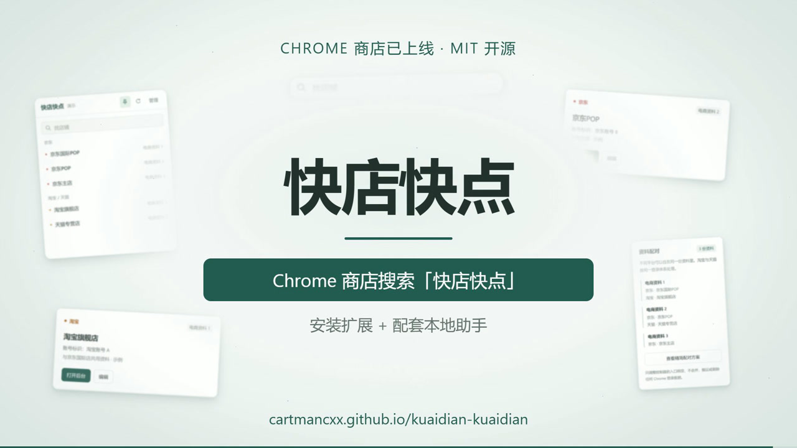
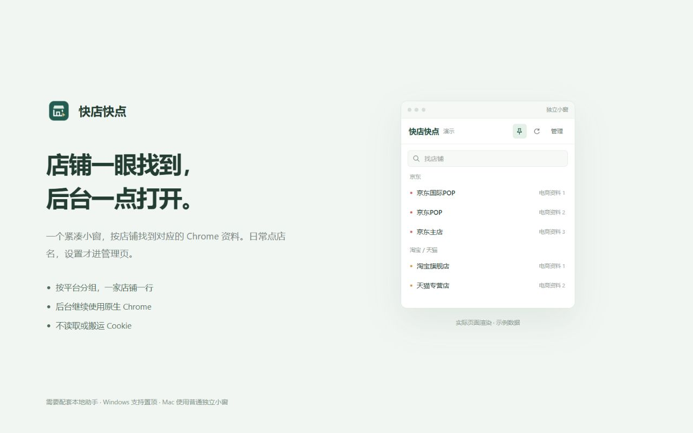
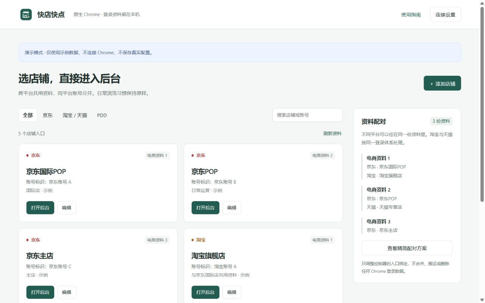

# 快店快点

**一个小窗，按店铺打开对应 Chrome 资料里的后台。**

京东、淘宝／天猫、拼多多后台太多？把店铺放进一个紧凑入口，点店名就向对应 Chrome 资料发送打开请求。网页、登录状态和其他插件继续由原生 Chrome 管理。

[从 Chrome 商店安装](https://chromewebstore.google.com/detail/快店快点/ckeiapojbffhmmedjajdbnpfongmfjmm) · [下载配套助手](https://github.com/Cartmancxx/kuaidian-kuaidian/releases/tag/v1.0.0-store.1) · [官网与安装指引](https://cartmancxx.github.io/kuaidian-kuaidian/) · [隐私政策](https://cartmancxx.github.io/kuaidian-kuaidian/privacy.html) · [反馈问题](https://github.com/Cartmancxx/kuaidian-kuaidian/issues)

> **Chrome 扩展已发布，源码继续按 MIT 开源。** 使用时仍需单独安装本地助手；Chrome 商店发布不代表本地助手已获操作系统签名、公证或安装验收。当前助手未做 Windows 代码签名、Mac 签名／公证；真实 Chrome 安装、Windows 置顶、Mac 实机安装和 GPT 跨资料控制仍待验收。系统可能提示未知发布者或阻止运行，请核对来源并遵循设备策略，不关闭系统防护。

## 32 秒产品宣传片

[](https://cartmancxx.github.io/kuaidian-kuaidian/#film)

真实产品界面，使用示例店铺数据；使用产品时需安装 **Chrome 扩展 + 本地助手**。

[在线观看](https://cartmancxx.github.io/kuaidian-kuaidian/#film) · [下载配乐版 MP4](https://github.com/Cartmancxx/kuaidian-kuaidian/releases/download/v1.0.0-store.1/kuaidian-kuaidian-launch.mp4) · [下载无配乐版 MP4（保留音效）](https://github.com/Cartmancxx/kuaidian-kuaidian/releases/download/v1.0.0-store.1/kuaidian-kuaidian-launch-sfx.mp4) · [宣传片源码工程](promotional-video/)

宣传片与官网属于主分支的后续营销更新，不改变已发布的 `v1.0.0-store.1` 助手、源码快照或标签。视频附件单独提供。

<details>
<summary>查看店铺小窗截图</summary>



</details>

## 能做什么

- 按平台分组、搜索店铺，点击打开对应资料下的后台。
- Windows 小窗申请置顶；Mac 使用普通独立小窗。
- 不同登录体系复用 Chrome 资料，同体系不同账号分开：例如 3 个京东账号 + 2 个淘宝账号，可规划为 3 份资料；淘宝和天猫属于同一体系。
- 绑定现有资料，配对先预览再确认；不读取或搬运 Cookie，不创建或删除 Chrome 资料。
- 使用原生 Chrome，不内嵌另一套浏览器。GPT／Codex 等扩展需在各资料中分别启用和连接，**尚未验证跨资料控制兼容性**。

这是入口控制器，不是“同一窗口不同 Cookie 的标签浏览器”。不会自动归组或复用已打开的业务标签，不识别实际登录店铺。点击成功仅代表打开请求已发出，登录到期仍需正常扫码或验证。

## 第一次安装：商店扩展 + 本地助手

需要两部分：扩展负责小窗，本地助手负责启动指定 Chrome 资料。普通扩展单独做不了跨资料启动。

支持目标：受支持版本的 **Windows 11 x64**；**macOS 15 及之后受 .NET 10 支持的版本**（Apple 芯片／Intel）。Chrome 116+，推荐最新稳定版。助手自带运行时，无需另装 .NET。

### 1. 从 Chrome 商店安装扩展

打开 [快店快点 · Chrome Web Store](https://chromewebstore.google.com/detail/快店快点/ckeiapojbffhmmedjajdbnpfongmfjmm)，点击“添加至 Chrome”，再在工具栏的拼图图标中固定“快店快点”。**商店安装不需要打开开发者模式。**

商店扩展 ID：`ckeiapojbffhmmedjajdbnpfongmfjmm`。

### 2. 安装对应系统的配套助手

从 [商店配套助手 Release · v1.0.0-store.1](https://github.com/Cartmancxx/kuaidian-kuaidian/releases/tag/v1.0.0-store.1) 下载匹配包：

| 你的电脑 | 下载文件 | 完整解压后运行 |
| --- | --- | --- |
| Windows 11，x64 | `ShopController-helper-1.0.0-win-x64.zip` | `Install.cmd` |
| Mac，Apple 芯片（M 系列） | `ShopController-helper-1.0.0-osx-arm64.zip` | `Install.command` |
| Mac，Intel | `ShopController-helper-1.0.0-osx-x64.zip` | `Install.command` |

**请认准 Release 标签 `v1.0.0-store.1`，不是旧 `v1.0.0`。** 文件名中的 1.0.0 是助手协议/产品版本；新 Release 的助手绑定正式商店 ID，旧包绑定开发者模式 ID，不能直接混用。

先完整解压再运行，不要只拖出安装脚本。安装按当前系统用户进行，不要求管理员权限，不修改 PowerShell 执行策略。若检测到旧版身份，安装器会拒绝直接覆盖；按下方迁移步骤显式更换绑定。本地店铺配置保留。

**Mac 限制：包尚未签名／公证，Gatekeeper 可能阻止启动；我们没有 Mac 实机安装成功的验证结论。** 不要关闭 Gatekeeper、防病毒或设备管理策略。遇到拦截请保留错误信息并反馈。

需要核对下载时，用该 Release 中的 `SHA256SUMS.txt` 对比文件摘要。Windows 可运行 `Get-FileHash 文件路径 -Algorithm SHA256`，Mac 可运行 `shasum -a 256 文件路径`。摘要可核对文件一致性，不等同于发布者代码签名。

### 3. 连接并添加店铺

1. 点 Chrome 工具栏“快店快点”→“连接助手”→重试，确认显示已连接。
2. 打开管理页，刷新现有 Chrome 资料列表。
3. 添加店铺：填写店名、平台、账号昵称、后台地址，再选择对应资料。
4. 返回小窗点店名，**在真实后台核对登录账号与店铺名称**。

首次使用先建两条测试入口，分别绑定两份资料、地址填 `https://example.com/`，确认路由，再配置真实店铺。主账号资料可以不加入自动配对池；尚未登记的账号不会参与冲突检查。



## 从旧 GitHub 公测版迁移

两个渠道的扩展身份不同，**只安装商店扩展而不更新助手，会连接失败**。

| 渠道 | 扩展 ID | 配套助手 Release |
| --- | --- | --- |
| Chrome 商店（推荐） | `ckeiapojbffhmmedjajdbnpfongmfjmm` | `v1.0.0-store.1` |
| 旧 GitHub 开发者模式 | `hadeebhijljjdebkaiaglaeipajnnind` | `v1.0.0` |

1. 关闭快店快点小窗和管理页；备份本地 `config.json` 和 `config.json.bak`（如存在，位置见下文）。无需退出店铺账号。
2. 在 `chrome://extensions` 中先停用旧的已解压扩展，避免两个同名入口混淆。
3. 从 Chrome 商店安装正式扩展。
4. 从 **v1.0.0-store.1** 下载并完整解压新配套助手，在该解压目录中显式运行换绑命令：Windows `Install.cmd --replace-identity`（PowerShell 中写作 `.\Install.cmd --replace-identity`）；Mac `./Install.command --replace-identity`。这是将本产品助手从旧 ID 改绑至正式商店 ID，不是删除配置或 Chrome 资料。
5. 回到商店扩展“连接助手”页重试，核对店铺列表和资料绑定，再停用或移除旧扩展。

助手安装保留本地店铺配置；Chrome Cookie、密码及登录状态不迁移、不改写。一个本地助手登记同一时间绑定一个扩展 ID，不把两个渠道同时当作可用入口。真实迁移流程仍需在你的环境验收。

<details>
<summary>开发者模式与旧公测包（开发用途）</summary>

旧 [v1.0.0 Release](https://github.com/Cartmancxx/kuaidian-kuaidian/releases/tag/v1.0.0) 保留 `ShopController-extension-unpacked-1.0.0.zip`。解压到长期目录，在 `chrome://extensions` 打开开发者模式，选择“加载已解压的扩展程序”，定位含 `manifest.json` 的文件夹；配套使用同一旧 Release 的助手。

固定公开 `manifest.key` 对应 ID `hadeebhijljjdebkaiaglaeipajnnind`，不是私钥。删除或替换 key 会改变 ID、需要重新绑定。开发者模式扩展需手动替换文件并刷新，不通过商店自动更新。切换回此渠道也需重新安装对应绑定的助手，别与商店版同时启用。

</details>

## 更新、卸载与常见问题

- **更新商店扩展**：通过 Chrome Web Store 的正常更新机制；本地助手不会因此自动更新。
- **更新助手**：从官网指向的配套 Release 下载同架构包，完整解压后运行安装器；配置保留。
- **卸载助手**：运行包内 `Uninstall.cmd` 或 `Uninstall.command`。默认取消通信登记并保留配置；Windows 保留程序，Mac 归档程序。扩展在 `chrome://extensions` 单独移除。
- **找不到资料**：先用 Chrome 打开对应资料一次，再刷新列表。设置里可手动指定 Chrome 程序和资料根目录。
- **打开后账号不对**：核对该店绑定的资料，在那份 Chrome 资料里正常登录；本工具不切换或注入 Cookie。
- **助手未连接**：首先核对渠道/扩展 ID，其次检查是否完整解压、架构匹配、系统是否拦截安装或启动。反馈时请附系统版本和脱敏报错。

## 数据留在哪里

仅保存店铺名称、账号昵称、后台地址、备注、资料绑定、最近打开时间等元数据。无自建云服务、广告或遥测，不读取 Cookie、密码或浏览历史数据库。Chrome 及其他插件仍按各自设置工作。

- Windows：`%LOCALAPPDATA%\ShopController\config.json`
- Mac：`~/Library/Application Support/ShopController/config.json`
- 上一版备份：同路径加 `.bak`。卸载默认保留；彻底清除时可自行删除这两个产品配置文件，不要删除 Chrome 资料目录。

店铺元数据也可能是商业信息。请勿在备注、网址或反馈中粘贴密码、Cookie、令牌、订单或客户信息。[完整隐私政策](https://cartmancxx.github.io/kuaidian-kuaidian/privacy.html)

## 开发与参与

项目使用原生 Manifest V3 扩展和 .NET 10 本地助手，核心库目标为 .NET 8。构建需要 .NET 10 SDK、Python 3.10+；测试还会使用 Node.js，具体说明见 [测试指南](ShopController.Tests/README.md)。

```sh
dotnet build ShopController/host/ShopController.Host.csproj -c Release
# 商店配套助手
python ShopController/scripts/publish_release.py --channel store --extension-id ckeiapojbffhmmedjajdbnpfongmfjmm --output-suffix store.1 --dotnet dotnet
# 开发者模式：保留公开 key，绑定其派生 ID
python ShopController/scripts/publish_release.py --channel github --output-suffix github --dotnet dotnet
```

商店配套输出在 `dist/ShopController-release-1.0.0-store.1`；上述开发者模式命令输出在 `dist/ShopController-release-1.0.0-github`，避免不同身份的产物相互覆盖。自动化检查不代表真实平台验收；扩展商店发布也不等于助手已获系统签名、公证。完整架构说明见 [产品文档](ShopController/README.md)，贡献方式见 [CONTRIBUTING](CONTRIBUTING.md)，漏洞反馈见 [SECURITY](SECURITY.md)。

## 许可与联系

[MIT License](LICENSE) · Copyright © 2026 程大意。随助手提供的 .NET 运行时和第三方组件保留各自许可证及通知。

开发者：程大意 · [cartmancxx@gmail.com](mailto:cartmancxx@gmail.com)。与京东、淘宝、天猫、拼多多及 Google 无隶属或官方合作关系。
