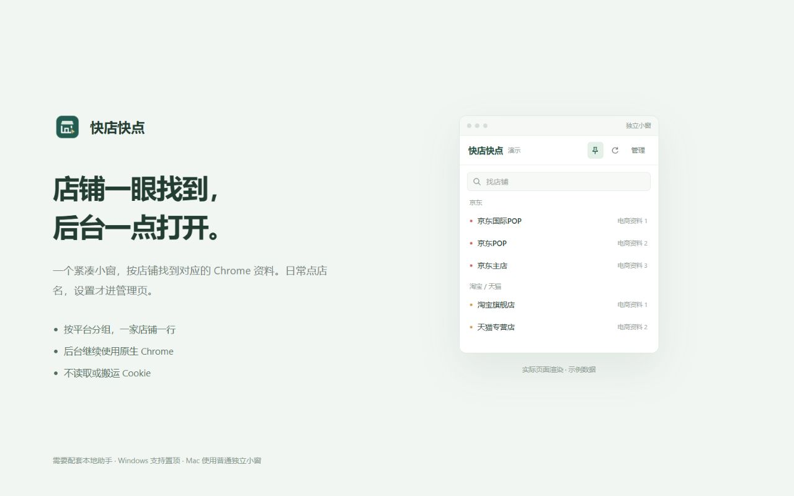
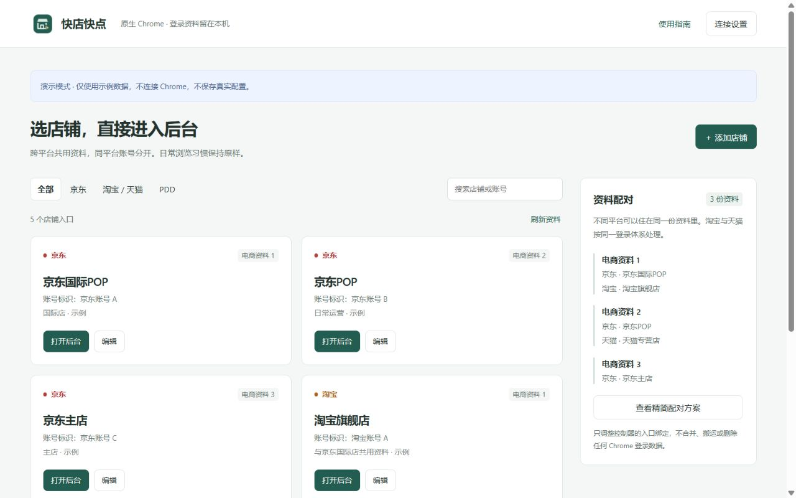

# 快店快点

**一个小窗，按店铺打开对应 Chrome 资料里的后台。**

京东、淘宝／天猫、拼多多后台太多？把店铺放进一个紧凑入口，点店名就向对应 Chrome 资料发送打开请求。网页、登录状态和其他插件继续由原生 Chrome 管理。

[下载公测版](https://github.com/Cartmancxx/kuaidian-kuaidian/releases/tag/v1.0.0) · [官网与安装指引](https://cartmancxx.github.io/kuaidian-kuaidian/) · [隐私政策](https://cartmancxx.github.io/kuaidian-kuaidian/privacy.html) · [反馈问题](https://github.com/Cartmancxx/kuaidian-kuaidian/issues)

> **当前为 GitHub 开源公测，不是 Chrome 商店版。** 助手尚未做 Windows 代码签名或 Mac 签名／公证；Mac 包为交叉构建，尚未在真实 Mac 上完成运行验收。真实 Chrome 安装、Windows 置顶与 GPT 跨资料控制仍需实测。系统可能提示未知发布者或阻止运行，请核对来源、摘要并遵循设备策略，不关闭系统防护。



## 能做什么

- 按平台分组、搜索店铺，点击打开对应资料下的后台。
- Windows 小窗申请置顶；Mac 使用普通独立小窗。
- 不同登录体系复用 Chrome 资料，同体系不同账号分开：例如 3 个京东账号 + 2 个淘宝账号，可规划为 3 份资料；淘宝和天猫属于同一体系。
- 绑定现有资料，配对先预览再确认；不读取或搬运 Cookie，不创建或删除 Chrome 资料。
- 使用原生 Chrome，不内嵌另一套浏览器。GPT／Codex 等扩展需在各资料中分别启用和连接，**尚未验证跨资料控制兼容性**。

这是入口控制器，不是“同一窗口不同 Cookie 的标签浏览器”。不会自动归组或复用已打开的业务标签，不识别实际登录店铺。点击成功仅代表打开请求已发出，登录到期仍需正常扫码或验证。

## 第一次安装：扩展 + 本地助手

需要两部分：扩展负责小窗，本地助手负责启动指定 Chrome 资料。普通扩展单独做不了跨资料启动。

支持目标：受支持版本的 **Windows 11 x64**；**macOS 15 及之后受 .NET 10 支持的版本**（Apple 芯片／Intel）。Chrome 116+，推荐最新稳定版。助手自带运行时，无需另装 .NET。

### 1. 下载并解压扩展

打开 [1.0.0 公测 Release](https://github.com/Cartmancxx/kuaidian-kuaidian/releases/tag/v1.0.0)，下载：

**`ShopController-extension-unpacked-1.0.0.zip`**

将它解压到准备长期保留的目录。解压后的文件夹中应直接看见 `manifest.json`。不要选名字不含 `unpacked` 的商店投稿包，也不要把 GitHub 自动生成的 `Source code` 当扩展包。

### 2. 加载到 Chrome

1. 在 Chrome 地址栏输入 `chrome://extensions`。
2. 打开右上角「开发者模式」。
3. 点击「加载已解压的扩展程序」，选择刚才包含 `manifest.json` 的文件夹。
4. 在 Chrome 工具栏的拼图图标中，把「快店快点」固定到工具栏。

GitHub 包保留固定公开 `manifest.key`，扩展 ID 为 `hadeebhijljjdebkaiaglaeipajnnind`。这不是私钥。请勿自行删除或替换它，否则需要重新绑定助手。

### 3. 安装对应系统的助手

| 你的电脑 | 下载文件 | 完整解压后运行 |
| --- | --- | --- |
| Windows 11，x64 | `ShopController-helper-1.0.0-win-x64.zip` | `Install.cmd` |
| Mac，Apple 芯片（M 系列） | `ShopController-helper-1.0.0-osx-arm64.zip` | `Install.command` |
| Mac，Intel | `ShopController-helper-1.0.0-osx-x64.zip` | `Install.command` |

从同一个 [Release 页面](https://github.com/Cartmancxx/kuaidian-kuaidian/releases/tag/v1.0.0) 下载匹配包，**先完整解压再运行**。不要只拖出安装脚本。安装按当前系统用户进行，不要求管理员权限，不修改 PowerShell 执行策略。若安装器询问扩展 ID，请复制扩展「连接助手」页显示的 ID。

**Mac 公测限制：包尚未签名／公证，Gatekeeper 可能阻止启动；我们没有 Mac 实机安装成功的验证结论。** 不要关闭 Gatekeeper、防病毒或设备管理策略。遇到拦截请保留错误信息并反馈，勿把包已下载当成安装已成功。

需要核对下载时，用 Release 中的 `SHA256SUMS.txt` 对比文件摘要；Windows 可运行 `Get-FileHash 文件路径 -Algorithm SHA256`，Mac 可运行 `shasum -a 256 文件路径`。摘要可核对文件一致性，不等同于发布者代码签名。

### 4. 连接并添加店铺

1. 点 Chrome 工具栏「快店快点」→「连接助手」→重试，确认显示已连接。
2. 打开管理页，刷新现有 Chrome 资料列表。
3. 添加店铺：填写店名、平台、账号昵称、后台地址，再选择对应资料。
4. 返回小窗点店名，**在真实后台核对登录账号与店铺名称**。

首次使用先建两条测试入口，分别绑定两份资料、地址填 `https://example.com/`，确认路由，再配置真实店铺。主账号资料可以不加入自动配对池；尚未登记的账号不会参与冲突检查。



## 更新、卸载与常见问题

- **更新扩展**：解压新 GitHub 包到原扩展目录，保持 `manifest.key`，然后在 `chrome://extensions` 点该扩展的刷新按钮。未打包扩展不会通过商店自动更新。
- **更新助手**：下载新版同架构助手，完整解压后运行安装器；配置保留。不要从已安装目录里重复执行安装。
- **卸载助手**：运行包内 `Uninstall.cmd` 或 `Uninstall.command`。默认取消通信登记并保留配置；Windows 保留程序，Mac 归档程序。扩展在 `chrome://extensions` 单独移除。
- **找不到资料**：先用 Chrome 打开对应资料一次，再刷新列表。设置里可手动指定 Chrome 程序和资料根目录。
- **打开后账号不对**：核对该店绑定的资料，在那份 Chrome 资料里正常登录；本工具不切换或注入 Cookie。
- **助手未连接**：检查是否完整解压、架构是否匹配、扩展 ID 是否一致，以及系统是否拦截安装或启动。反馈时请附系统版本和脱敏报错。

## 数据留在哪里

仅保存店铺名称、账号昵称、后台地址、备注、资料绑定、最近打开时间等元数据。无自建云服务、广告或遥测，不读取 Cookie、密码或浏览历史数据库。Chrome 及其他插件仍按各自设置工作。

- Windows：`%LOCALAPPDATA%\ShopController\config.json`
- Mac：`~/Library/Application Support/ShopController/config.json`
- 上一版备份：同路径加 `.bak`。卸载默认保留；彻底清除时可自行删除这两个产品配置文件，不要删除 Chrome 资料目录。

店铺元数据也可能是商业信息。请勿在备注、网址或反馈中粘贴密码、Cookie、令牌、订单或客户信息。[完整隐私政策](https://cartmancxx.github.io/kuaidian-kuaidian/privacy.html)

## 开发与参与

项目使用原生 Manifest V3 扩展和 .NET 10 本地助手，核心库目标为 .NET 8。构建需要 .NET 10 SDK、Python 3.10+；测试还会使用 Node.js，具体说明见 [测试指南](ShopController.Tests/README.md)。

```sh
dotnet build ShopController/host/ShopController.Host.csproj -c Release
python ShopController/scripts/publish_release.py --channel github --dotnet dotnet
```

发布输出在 `dist/ShopController-release-1.0.0`。源码和自动化检查通过不代表真实平台验收或商店审核完成。完整架构说明见 [产品文档](ShopController/README.md)，贡献方式见 [CONTRIBUTING](CONTRIBUTING.md)，漏洞反馈见 [SECURITY](SECURITY.md)。

## 许可与联系

[MIT License](LICENSE) · Copyright © 2026 程大意。随助手提供的 .NET 运行时和第三方组件保留各自许可证及通知。

开发者：程大意 · [cartmancxx@gmail.com](mailto:cartmancxx@gmail.com)。与京东、淘宝、天猫、拼多多及 Google 无隶属或官方合作关系。
